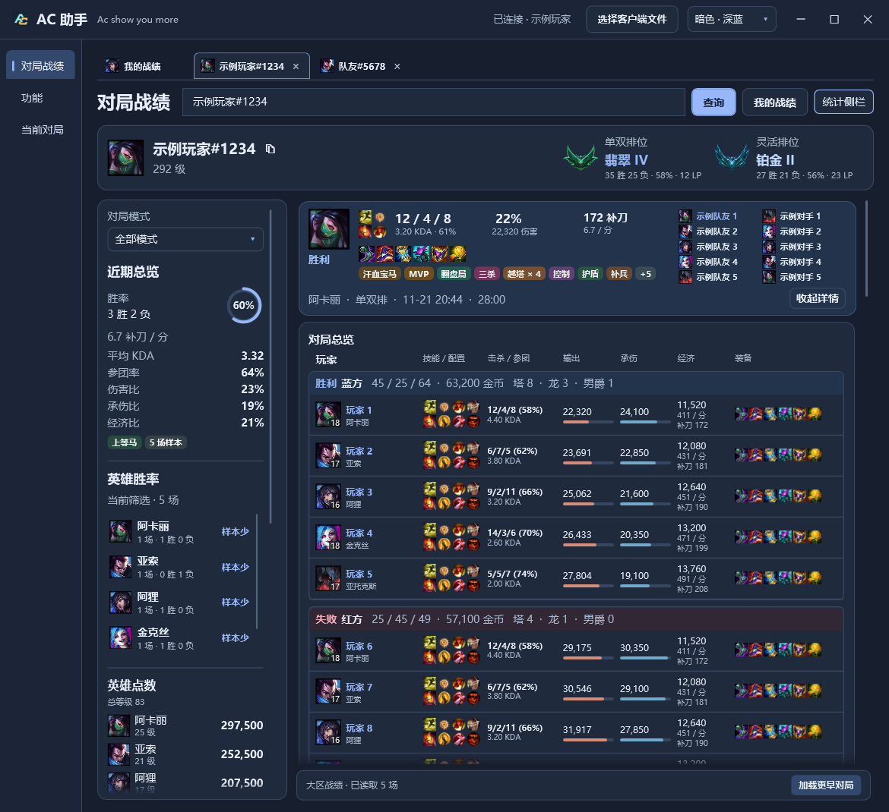
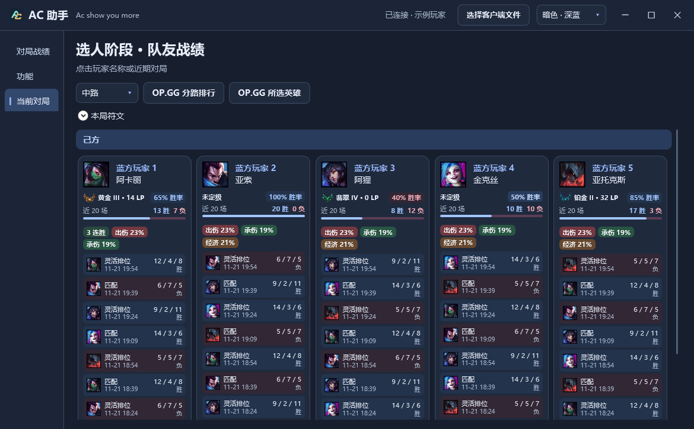

# AC Helper（AC 助手）

国服英雄联盟的 Windows 战绩和选人助手。

**[下载 Windows x64 发布包](https://github.com/achengz/ACHelper/releases/latest)** · [问题反馈](https://github.com/achengz/ACHelper/issues)

安装 [.NET 8 Desktop Runtime x64](https://dotnet.microsoft.com/download/dotnet/8.0)，登录国服客户端，解压发布包并运行 `ACHelper.exe`。OP.GG 侧窗需要 [Microsoft Edge WebView2 Runtime](https://developer.microsoft.com/microsoft-edge/webview2/)。

- **战绩查询**支持搜索同区玩家和展开单局记分板。大区服务可用时可加载更早对局。悬停 K/D/A 可查看雷达图，悬停点评标签可查看依据。
- **选人面板**在锁定前显示公开队友的段位、近期胜负和最多 10 场对局。点击玩家名可打开完整战绩，匿名席位显示占位卡。
- **选人工具**支持应用或导入符文、在侧窗查看 OP.GG 攻略。自动接受和自动预选默认关闭，可分别设置。

## 截图（示例数据）





## 从源码构建

在 Windows 上安装 .NET 8 SDK，然后在仓库目录执行以下命令。

```powershell
dotnet publish -c Release --self-contained false
```

运行 `ACHelper.exe --self-test report.txt` 可执行样例检查。反馈时请提供客户端版本、游戏模式和复现步骤，公开帖中请勿附上 lockfile、令牌、完整诊断文件或玩家个人信息。[维护者 @achengz](https://github.com/achengz)

## 免责声明与致谢

AC 助手是独立的第三方项目，未获 Riot Games 背书，也不代表 Riot Games 或负责制作、管理其产品的人员的观点。本项目与腾讯及 OP.GG 无隶属关系，也未获其背书。Riot Games 及相关产品名称是 Riot Games, Inc. 的商标或注册商标，游戏素材归各自权利人所有。软件按现状提供，功能和数据可用性受客户端版本、大区和隐私设置影响。使用时请遵守游戏和平台规则。[Riot Games 开发者政策](https://developer.riotgames.com/policies/general)

战绩来自本机客户端和腾讯大区服务，点评标签根据可读取的单局数据评估队内相对表现。

感谢 Hanxven 与 League Akari 贡献者提供选人和对局模块参考，也感谢 CommunityDragon 维护简体中文游戏数据。排位徽章来自 Riot Games，攻略由 OP.GG 提供。[League Akari](https://github.com/LeagueAkari/LeagueAkari) · [上游 MIT 许可](https://github.com/LeagueAkari/LeagueAkari/blob/dev/LICENSE) · [CommunityDragon](https://github.com/CommunityDragon)
